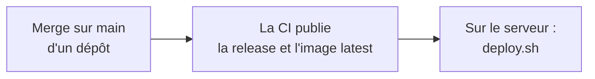

# FlorAccess — Wrapper

Ce dépôt lance **tout l'écosystème FlorAccess d'un coup** : reverse proxy Traefik, base de données, migrations, API et panel d'administration.

Il ne définit aucun service et ne contient aucune version. Chaque dépôt garde son `docker-compose.yml` de production à côté de son code, et le wrapper assemble toujours leur dernière release. Il n'y a donc rien à modifier ici quand un dépôt change.

# Table des matières

- [FlorAccess — Wrapper](#floraccess--wrapper)
- [Table des matières](#table-des-matières)
- [Comment ça fonctionne](#comment-ça-fonctionne)
- [Réseaux](#réseaux)
- [Structure](#structure)
- [Prérequis](#prérequis)
- [Mettre en service](#mettre-en-service)
  - [Reprendre une ancienne installation](#reprendre-une-ancienne-installation)
- [Mettre à jour](#mettre-à-jour)
  - [Une nouvelle release d'un dépôt](#une-nouvelle-release-dun-dépôt)
  - [Une release qui demande une nouvelle variable](#une-release-qui-demande-une-nouvelle-variable)
  - [Une modification de ce dépôt](#une-modification-de-ce-dépôt)
  - [Un changement de réglage ou de domaine](#un-changement-de-réglage-ou-de-domaine)
- [Revenir en arrière](#revenir-en-arrière)
- [Si GitHub est injoignable](#si-github-est-injoignable)
- [Sauvegarder et restaurer](#sauvegarder-et-restaurer)
  - [Sauvegarder depuis ta machine](#sauvegarder-depuis-ta-machine)
  - [Comment elles sont chiffrées](#comment-elles-sont-chiffrées)
  - [Créer la clé de sauvegarde](#créer-la-clé-de-sauvegarde)
  - [Restaurer](#restaurer)
  - [Sauvegarder et restaurer env/](#sauvegarder-et-restaurer-env)
- [Changer un secret](#changer-un-secret)
  - [Le mot de passe de la base](#le-mot-de-passe-de-la-base)
  - [La clé JWT](#la-clé-jwt)
  - [Le mot de passe du compte email](#le-mot-de-passe-du-compte-email)
- [Essayer en local](#essayer-en-local)
- [Ce qu'un dépôt doit respecter](#ce-quun-dépôt-doit-respecter)

# Comment ça fonctionne



Le wrapper assemble trois sources :

| Quoi | D'où ça vient | Qui le gère |
|---|---|---|
| Comment lancer chaque service | Le `docker-compose.yml` de chaque dépôt, sur sa branche `main` | Chaque dépôt |
| Le programme | Les images Docker `latest` | La CI de chaque dépôt |
| Les secrets et réglages de cette machine | Le dossier `env/`, jamais versionné | Toi, sur le serveur |

- **Tout passe par `include`, une fonction native de Docker Compose.** `docker-compose.yml` pointe vers le fichier de chaque dépôt sur GitHub. Compose le télécharge et le met en cache lui-même.
- **`main` tient lieu de « dernière release »** : la CI publie une version à chaque merge sur `main`. Git n'a pas de référence vers « la dernière release », et Compose ne sait inclure que depuis une référence git.
- **Chaque dépôt lit son propre dossier dans `env/`**, comme s'il tournait seul. Les noms de variables ne peuvent donc pas entrer en conflit.
- **`docker-compose.override.yml` relie les dépôts** : il branche Traefik sur le réseau de chaque service exposé, donne à l'API son propre rôle dans la base, et garantit que les migrations et ce rôle sont prêts avant le démarrage de l'API.
- **L'API n'utilise pas le propriétaire de la base.** Elle se connecte avec le rôle `floraccess_api`, qui peut seulement lire et écrire les lignes des tables : une injection SQL ne pourrait ni modifier le schéma ni exécuter de code sur le serveur. Le service `floraccess-api-role` de `floraccess-database` crée ce rôle et lui donne ses droits à chaque déploiement.

Au lancement de `deploy.sh`, dans l'ordre :

1. **Vérifie `env/`.** Il s'arrête si un `.env` ou un secret vient d'être créé, si une release demande une nouvelle variable, si le mot de passe email manque ou si les sauvegardes ne peuvent pas être chiffrées. Rien n'a encore été touché.
2. **Télécharge les images.**
3. **Sauvegarde et chiffre la base**, si elle tourne déjà.
4. **Démarre tout dans l'ordre** : la base, les migrations manquantes, le rôle de l'API, puis l'API. Traefik et le panel d'administration démarrent en parallèle. Si une migration échoue, l'API n'est pas mise à jour et le script s'arrête en erreur.
5. **Recrée le conteneur du panel**, pour qu'il serve bien la configuration actuelle.

# Réseaux

Compose crée tous les réseaux au démarrage : il n'y a rien à préparer. Un service ne partage un réseau qu'avec ceux à qui il doit parler.

| Réseau | Accès à Internet | Qui le rejoint | À quoi il sert |
|---|---|---|---|
| `traefik-net` | Oui, IPv6 compris | Traefik | Ports 80 et 443, certificats Let's Encrypt |
| `floraccess-api-net` | Non | Traefik, API | Requêtes vers l'API |
| `floraccess-app-net` | Non | Traefik, panel d'administration | Requêtes vers le panel |
| `floraccess-database-net` | Non | API, base, migrations, rôle de l'API | Accès à la base |
| `floraccess-api-egress-net` | Oui | API | Envoi des emails (codes de connexion, vérifications) |

Ce que cela garantit :

- **Les services exposés ne peuvent pas se joindre entre eux.** Seul Traefik les atteint, et chacun avec son propre réseau.
- **Seuls l'API, les migrations et le service qui crée le rôle de l'API atteignent la base.** Traefik ne la voit pas.
- **La base et le panel n'ont aucun accès à Internet.** Une image compromise ne peut rien envoyer dehors.
- **Aucun conteneur n'a accès à l'API Docker.** Traefik lit ses routes dans `dynamic/routes.yml` de `floraccess-proxy`.

# Structure

```
floraccess-wrapper/
├── docker-compose.yml            ← liste des dépôts à assembler
├── docker-compose.override.yml   ← ce qui relie les dépôts (chargé automatiquement)
├── docker-compose.local.yml      ← essai local : ports sur 127.0.0.1
├── env/                          ← configuration de cette machine (jamais versionnée)
│   ├── backup-recipients.txt     ← clé publique qui chiffre les sauvegardes
│   ├── proxy/.env
│   ├── database/
│   │   ├── .env
│   │   └── secrets/              ← mots de passe de la base et de l'API, connexion des migrations
│   ├── api/
│   │   ├── .env
│   │   └── secrets/              ← mot de passe du compte email, clé qui signe les JWT
│   └── app/.env
├── backups/                      ← sauvegardes chiffrées de la base et de env/ (jamais versionnées)
├── config/                       ← configuration du panel pour l'essai local
└── scripts/
    ├── deploy.sh                 ← vérifie, sauvegarde, puis démarre ou met à jour
    ├── backup.sh                 ← sauvegarde et chiffre la base dans backups/
    ├── backup-env.sh             ← sauvegarde et chiffre env/ dans backups/
    ├── sync-env.sh               ← crée env/ et repère les variables et secrets manquants
    ├── rotate-database-password.sh ← change les mots de passe de la base et de l'API
    └── lib/                      ← fonctions partagées entre les scripts (env/, sauvegardes et SSH)
```

⚠️ **`env/app/.env` est servi à tous les visiteurs par nginx.** Ne jamais y mettre de secret.

Les fichiers de `secrets/` sont lisibles par tous sur la machine, parce que chaque conteneur les lit avec son propre utilisateur : c'est le dossier, en `700`, qui les protège. Ne pas changer ces droits.

# Prérequis

- Docker 27 ou plus récent, avec Compose 2.20 ou plus récent, ainsi que `git`, `curl`, `openssl` et `age`.
- **Une paire de clés de sauvegarde**, créée sur ta machine et non sur le serveur. Voir [Créer la clé de sauvegarde](#créer-la-clé-de-sauvegarde).
- **Une session sur le registre des images durcies**, d'où vient l'image de la base :

    ```bash
    docker login dhi.io
    ```

- **Les ports 80 et 443 libres**, donc aucun autre Traefik lancé. ⚠️ `econoris-wrapper` lance aussi un Traefik sur ces ports : **les deux wrappers ne peuvent pas tourner sur le même serveur tels quels**. Voir « Un seul proxy par serveur » dans le README de `floraccess-proxy`.
- **Les domaines qui pointent vers le serveur** : `api.floraccess.florobart.fr`, `floraccess.florobart.fr`, et `floraccess-server.florobart.fr` tant que l'ancienne adresse de l'API est utilisée.
- **Le compte email** qui envoie les codes de connexion : son adresse et son mot de passe (ou mot de passe d'application).
- **Des dépôts conformes à [ces règles](#ce-quun-dépôt-doit-respecter), publiés sur `main`.**

# Mettre en service

1. Récupérer ce dépôt sur le serveur, puis se placer dans son dossier.

2. Créer la configuration. Les mots de passe de la base et de l'API ainsi que la clé JWT sont générés, et les adresses publiques sont déjà remplies :

    ```bash
    ./scripts/sync-env.sh
    ```

3. Relire `env/`, et remplir à la main :

    - `LETSENCRYPT_EMAIL` dans `env/proxy/.env` ;
    - `MAIL_USERNAME` dans `env/api/.env`, et le mot de passe de ce compte, seul dans `env/api/secrets/mail_password` ;
    - `CORS_ALLOWED_ORIGINS` dans `env/api/.env` : vérifier qu'il contient toutes les applications web qui utilisent FlorAccess ;
    - la clé publique de sauvegarde, seule sur sa ligne dans le fichier `env/backup-recipients.txt`.

4. **Uniquement pour reprendre une ancienne installation** : suivre [Reprendre une ancienne installation](#reprendre-une-ancienne-installation). À faire avant l'étape suivante.

5. Démarrer :

    ```bash
    ./scripts/deploy.sh
    ```

6. Vérifier que `floraccess-migrate`, `floraccess-api-role` et `traefik-certificates-init` sont `Exited (0)` et que les autres services sont `Up` :

    ```bash
    docker compose ps --all
    ```

7. Vérifier, avec une visite en IPv6, que le journal affiche la vraie adresse du visiteur et non une adresse `172.x` :

    ```bash
    docker compose logs traefik
    ```

8. Sauvegarder `env/` hors du serveur (voir [Sauvegarder et restaurer env/](#sauvegarder-et-restaurer-env)) : il contient la seule copie de la clé JWT et des mots de passe.

## Reprendre une ancienne installation

Pour une installation de FlorAccess faite avec l'ancien système (dossier `Database/` de `FlorAccess_server`, lancé par `Flower_garden`). Ne pas lancer `deploy.sh` avant la fin de ces étapes : il créerait les tables, et la sauvegarde entrerait en conflit avec elles.

1. **Garder la clé JWT actuelle** : la copier, seule dans le fichier, dans `env/api/secrets/jwt_signing_key`, à la place de celle générée par `sync-env.sh`. Une nouvelle clé déconnecterait tous les utilisateurs de toutes les applications qui utilisent FlorAccess.

2. Sauvegarder l'ancienne base et vérifier qu'elle a bien les colonnes des migrations `502` à `505` : voir les étapes 1 à 4 de « Basculer une base existante » dans le README de `floraccess-database`. Faire la sauvegarde **sans propriétaire ni droits** (`pg_dump --no-owner --no-privileges`) : elle se restaure alors quel que soit `DB_USER` dans `env/database/.env`. Le sortir en `gzip` :

    ```bash
    docker compose exec -T <SERVICE_DB> pg_dump --no-owner --no-privileges -U <DB_USER> -d <DB_NAME> | gzip > floraccess_ancienne_base.sql.gz
    ```

3. Démarrer uniquement la base :

    ```bash
    docker compose up --detach --wait floraccess-database
    ```

4. Restaurer la sauvegarde. Cette commande attend un dump SQL compressé en `gzip`, non chiffré. Pour une sauvegarde en `.age`, utiliser la commande de [Restaurer](#restaurer) :

    ```bash
    gunzip -c floraccess_ancienne_base.sql.gz | docker compose exec -T floraccess-database sh -c 'psql -v ON_ERROR_STOP=1 -U "$POSTGRES_USER" -d "$POSTGRES_DB"'
    ```

5. Indiquer que la migration de départ est déjà appliquée, puisque les tables existent. Cette commande ne change rien si c'est déjà le cas :

    ```bash
    echo "CREATE TABLE IF NOT EXISTS schema_migrations (version VARCHAR(128) PRIMARY KEY); INSERT INTO schema_migrations (version) VALUES ('20261108120000') ON CONFLICT DO NOTHING;" | docker compose exec -T floraccess-database sh -c 'psql -v ON_ERROR_STOP=1 -U "$POSTGRES_USER" -d "$POSTGRES_DB"'
    ```

6. Reprendre à l'étape 5 de [Mettre en service](#mettre-en-service).

Tout scénario de reprise se répète d'abord en local, avec la vraie sauvegarde.

# Mettre à jour

## Une nouvelle release d'un dépôt

Attendre la fin de la CI du dépôt, puis lancer :

```bash
./scripts/deploy.sh
```

C'est tout, et il est inutile de faire un `git pull` : Compose récupère lui-même les nouveaux fichiers. La commande met à jour tous les dépôts d'un coup, et on peut la relancer autant de fois que nécessaire.

⚠️ À respecter :

- **Toujours passer par `deploy.sh`.** Un simple `docker compose up` prendrait le nouveau `docker-compose.yml` avec les anciennes images.
- **Attendre la fin de la CI après un merge sur `main`.** Le `docker-compose.yml` est disponible tout de suite, l'image seulement à la fin de la CI.
- **Tout ce qui arrive sur `main` part au prochain déploiement**, y compris si la CI a échoué après le merge : `main` est alors en avance sur la dernière release.

Si la base redémarre ou est recréée par une mise à jour, l'API rétablit seule sa connexion : il est inutile de la redémarrer.

## Une release qui demande une nouvelle variable

`deploy.sh` s'arrête avant de toucher à quoi que ce soit et affiche, par exemple :

```
Missing in env/api/.env: MA_NOUVELLE_VARIABLE
```

Ajouter la variable dans le fichier indiqué, puis relancer `./scripts/deploy.sh`.

## Une modification de ce dépôt

Si le wrapper lui-même change (un nouveau dépôt à assembler, un script corrigé) :

```bash
git pull
```

```bash
./scripts/deploy.sh
```

## Un changement de réglage ou de domaine

Modifier le fichier concerné dans `env/`, puis relancer `./scripts/deploy.sh`.

Les adresses écrites dans `scripts/sync-env.sh` ne servent qu'à la création de `env/` : les changer n'a aucun effet sur un `.env` existant. Un domaine se change dans `dynamic/routes.yml` de `floraccess-proxy`, puis passe par `main`. L'adresse de l'API se change aussi dans le `connect-src` du `nginx.conf` de `floraccess-app`, sinon le navigateur bloque ses appels, et dans `env/api/.env` (`BASE_URL`) et `env/app/.env` (`DATA_URL`).

# Revenir en arrière

Pour revenir à une ancienne image, écrire sa version dans un fichier `.env` à la racine de ce dépôt (il n'est pas versionné), puis relancer `./scripts/deploy.sh` :

```bash
MIGRATIONS_VERSION=1.0.0
API_VERSION=3.0.0
APP_VERSION=2.0.0
```

Seules les lignes utiles sont nécessaires. Supprimer la ligne pour revenir à la dernière release.

Trois limites :

- **Seule l'image revient en arrière**, pas son `docker-compose.yml` : pour celui-ci, il faut publier une nouvelle release du dépôt.
- **Les migrations ne reviennent pas en arrière.** Si la version annulée a modifié le schéma, il faut soit une migration corrective, soit restaurer la sauvegarde prise par `deploy.sh`.
- **L'image de l'ancienne version doit encore exister sur le registre.**

# Si GitHub est injoignable

`docker compose` lit les fichiers des dépôts sur GitHub. Sans GitHub, `up`, `pull` et donc `deploy.sh` échouent : aucun déploiement n'est possible.

Ce qui tourne n'est pas touché : les conteneurs continuent et redémarrent seuls, et `scripts/backup.sh` fonctionne. Les commandes `ps`, `logs`, `exec`, `restart`, `stop` et `start` marchent aussi, à condition de donner le nom du projet :

```bash
docker compose -p floraccess ps
```

```bash
docker compose -p floraccess logs floraccess-api
```

```bash
docker compose -p floraccess restart floraccess-api
```

# Sauvegarder et restaurer

Sauvegarder (`deploy.sh` le fait déjà avant chaque mise à jour) :

```bash
./scripts/backup.sh
```

Les 30 dernières sauvegardes sont gardées dans `backups/` (`BACKUP_RETENTION_COUNT` pour changer ce nombre). Elles sont sur le même disque que la base : **il faut aussi les copier ailleurs** pour survivre à une panne du serveur. Comme elles sont chiffrées, l'endroit où tu les copies n'a pas besoin d'être de confiance.

## Sauvegarder depuis ta machine

`backup.sh` et `backup-env.sh` peuvent aussi se lancer **depuis ta machine**, à travers SSH : la sauvegarde est écrite directement chez toi, ce qui en fait aussi la copie hors du serveur. Il suffit d'avoir ce dépôt sur ta machine, sans `env/` ni `age`.

```bash
./scripts/backup.sh -p 2222 -o ~/sauvegardes/floraccess floris@florobart.fr:/srv/floraccess-wrapper
./scripts/backup-env.sh -p 2222 -o ~/sauvegardes/floraccess floris@florobart.fr:/srv/floraccess-wrapper
```

- **La source** est le dossier `floraccess-wrapper` du serveur, écrit comme pour `scp` : `[utilisateur@]serveur:chemin`, avec un chemin absolu ou relatif au dossier personnel. Un chemin sans `serveur:` désigne un dossier de ta machine. Sans source, c'est le dossier du script.
- **`-p`** donne le port SSH. Sans lui, c'est celui de `~/.ssh/config`, sinon 22.
- **`-o`** donne le dossier où écrire. Sans lui, c'est `backups/` à côté du script. Les 30 dernières sauvegardes de ce dossier sont gardées.
- **Le chiffrement a lieu sur le serveur**, avec sa clé publique : seule la version chiffrée passe par SSH. Le serveur a besoin de `age` et de `env/backup-recipients.txt`, comme pour `deploy.sh`.
- L'utilisateur SSH doit pouvoir lancer `docker` pour `backup.sh`, et lire `env/` pour `backup-env.sh`.

`./scripts/backup.sh -h` détaille toutes les options.

Les sauvegardes ne contiennent pas les droits des tables : ils nomment le rôle de l'API, qui n'existe pas encore dans une base vide, et la restauration échouerait. `floraccess-api-role` les redonne au déploiement qui suit la restauration.

## Comment elles sont chiffrées

Les sauvegardes sont chiffrées avec [age](https://age-encryption.org) dès leur création : le dump en clair n'est jamais écrit sur le disque. Le chiffrement utilise deux clés :

| Clé | Où elle se trouve | Ce qu'elle permet |
|---|---|---|
| Publique | `env/backup-recipients.txt` sur le serveur | Chiffrer |
| Privée | **Uniquement hors du serveur** | Déchiffrer |

Une personne qui prend le contrôle du serveur ou vole son disque ne peut donc pas lire les sauvegardes. Cela ne protège pas la base en service, dont les données restent lisibles sur le serveur.

Sans clé publique valide ou sans `age`, `backup.sh` et `deploy.sh` s'arrêtent : aucune sauvegarde n'est écrite en clair.

⚠️ **Sans la clé privée, les sauvegardes sont définitivement perdues.** Personne ne peut les récupérer. Il faut en garder une copie à deux endroits, par exemple un gestionnaire de mots de passe et une clé USB rangée en lieu sûr.

## Créer la clé de sauvegarde

Sur ta machine, jamais sur le serveur :

```bash
age-keygen -o floraccess-backup.key
```

La commande affiche la clé publique, qui commence par `age1`. Elle va dans `env/backup-recipients.txt` sur le serveur.

Pour changer de clé, remplacer la ligne de ce fichier. Les anciennes sauvegardes restent lisibles uniquement avec l'ancienne clé privée : ne la supprimer qu'une fois ces sauvegardes supprimées. Le fichier accepte une clé par ligne : chaque clé listée peut alors déchiffrer seule les nouvelles sauvegardes.

## Restaurer

La restauration se lance **depuis ta machine**, où se trouve la clé privée : la sauvegarde est déchiffrée sur ta machine, et ni la clé ni le dump ne sont écrits sur le serveur. Le dump passe seulement par la connexion SSH.

1. Récupérer la sauvegarde, sauf si tu en as déjà une copie :

    ```bash
    scp <serveur>:<dossier du wrapper>/backups/<fichier>.sql.gz.age .
    ```

2. Sur le serveur, démarrer uniquement la base. Elle doit être **vide** :

    ```bash
    docker compose up --detach --wait floraccess-database
    ```

3. Sur ta machine, restaurer :

    ```bash
    age --decrypt --identity floraccess-backup.key <fichier>.sql.gz.age | ssh <serveur> 'cd <dossier du wrapper> && gunzip -c | docker compose exec -T floraccess-database sh -c "psql -v ON_ERROR_STOP=1 -U \$POSTGRES_USER -d \$POSTGRES_DB"'
    ```

4. Sur le serveur, tout démarrer :

    ```bash
    ./scripts/deploy.sh
    ```

Il faut tester régulièrement cette restauration, en local : c'est la seule façon de vérifier que la clé privée conservée est la bonne.

## Sauvegarder et restaurer env/

`env/` contient **la seule copie** des mots de passe de la base et de l'API, de la clé qui signe les JWT et du mot de passe du compte email. Les sauvegardes de la base ne les contiennent pas : sans `env/`, une base restaurée ne serait plus accessible, et tous les utilisateurs seraient déconnectés. Il faut le sauvegarder après l'installation et après chaque changement, en particulier après [un changement de secret](#changer-un-secret) :

```bash
./scripts/backup-env.sh
```

L'archive est écrite dans `backups/` sous le nom `floraccess-env_<date>.tar.gz.age`, avec **la même clé publique** que les sauvegardes de la base : quiconque a la clé privée peut déjà lire toutes les données, auxquelles ces secrets donnent seulement accès. Les 30 dernières sont gardées (`BACKUP_RETENTION_COUNT`). Comme pour la base, **il faut la copier hors du serveur**, ou la faire [depuis ta machine](#sauvegarder-depuis-ta-machine) avec les mêmes options que `backup.sh`.

Pour la lire, sur ta machine :

```bash
mkdir env-restauré
age --decrypt --identity floraccess-backup.key <fichier>.tar.gz.age | tar --extract --gzip --file - --directory env-restauré
```

Pour la remettre sur le serveur, depuis ta machine. Les fichiers déjà présents dans `env/` ne sont **pas remplacés** : `tar` les signale, et il faut les supprimer d'abord pour les reprendre de l'archive :

```bash
age --decrypt --identity floraccess-backup.key <fichier>.tar.gz.age | ssh <serveur> 'cd <dossier du wrapper> && tar --extract --gzip --file - --keep-old-files --preserve-permissions'
```

# Changer un secret

Les secrets ne sont jamais affichés : ils se lisent dans leur fichier de `env/`. Après chaque changement, [sauvegarder `env/`](#sauvegarder-et-restaurer-env).

## Le mot de passe de la base

La base doit être démarrée. Le script change les deux mots de passe de la base, celui de son propriétaire et celui du rôle de l'API, dans PostgreSQL et dans `env/database/secrets/`. Il redémarre ensuite l'API, qui est coupée quelques secondes.

```bash
./scripts/rotate-database-password.sh
```

Pour choisir le mot de passe du propriétaire (lettres et chiffres uniquement). Il reste alors dans l'historique du terminal. Celui de l'API est toujours généré :

```bash
./scripts/rotate-database-password.sh <nouveau_mot_de_passe>
```

Pour afficher l'aide :

```bash
./scripts/rotate-database-password.sh -h
```

Ne pas modifier ces mots de passe à la main dans `env/database/secrets/` : PostgreSQL garderait l'ancien mot de passe du propriétaire, et l'API, qui ne relit pas le sien sans redémarrer, perdrait l'accès à la base au déploiement suivant.

## La clé JWT

⚠️ **Changer la clé déconnecte tous les utilisateurs** de toutes les applications qui utilisent FlorAccess : les JWT déjà distribués ne sont plus valides. Elle protège aussi les jetons des liens envoyés par email : les liens de vérification et de blocage déjà envoyés, et les codes de connexion en attente, ne fonctionnent plus non plus. À ne faire que si la clé a fuité.

1. Écrire une nouvelle clé, seule dans le fichier :

    ```bash
    openssl rand -hex 64 > env/api/secrets/jwt_signing_key
    ```

2. Redémarrer l'API, qui ne lit la clé qu'à son démarrage. Forcé, car Compose ne détecte pas le changement d'un fichier monté :

    ```bash
    docker compose up --detach --wait --no-deps --force-recreate floraccess-api
    ```

L'API ne démarre pas sans clé : il n'y a pas de clé par défaut.

## Le mot de passe du compte email

Le remplacer, seul dans le fichier `env/api/secrets/mail_password`, puis redémarrer l'API comme pour [la clé JWT](#la-clé-jwt) (étape 2).

# Essayer en local

Lance la vraie stack de production, sans Traefik, sur `127.0.0.1`. Toutes les commandes du terminal doivent utiliser le fichier local :

```bash
export COMPOSE_FILE=docker-compose.yml:docker-compose.override.yml:docker-compose.local.yml
```

```bash
./scripts/sync-env.sh
```

Traefik ne démarre pas, mais Compose lit quand même son fichier : mettre n'importe quelle adresse dans `LETSENCRYPT_EMAIL` de `env/proxy/.env`. Remplir aussi `env/api/secrets/mail_password` : sans lui, `sync-env.sh` bloque le déploiement.

Les sauvegardes sont chiffrées aussi en local : `age` et une clé publique dans `env/backup-recipients.txt` sont nécessaires.

```bash
./scripts/deploy.sh
```

- Panel d'administration : <http://localhost:26007>
- API : <http://localhost:26001>

L'essai local d'Éconoris appelle FlorAccess sur le port `26001` de la machine : les deux essais fonctionnent ensemble, et l'API accepte les appels de l'application Éconoris locale (`http://localhost:26003`).

Si la stack a déjà été lancée sans le fichier local sur cette machine, lancer d'abord `docker compose down` sans `COMPOSE_FILE` : Traefik garderait sinon les réseaux que l'essai doit recréer.

Tout supprimer, données de l'essai comprises (⚠️ à ne jamais lancer en production) :

```bash
docker compose down --volumes
```

Pour développer, utiliser le `docker-compose.dev.yml` du dépôt concerné.

# Ce qu'un dépôt doit respecter

Ces règles sont les mêmes que pour `econoris-wrapper`, et valent pour tout dépôt ajouté à un wrapper.

Dans son `docker-compose.yml` :

- **Version de l'image en variable** : `image: florobart/mon-projet:${MON_PROJET_VERSION:-latest}`. Elle sert à [revenir en arrière](#revenir-en-arrière). Cette variable ne doit pas figurer dans son `.env.example`, sinon la version resterait figée.
- **Aucun port publié et aucun label Traefik.** L'accès se fait par une route dans `dynamic/routes.yml` de `floraccess-proxy`.
- **Un `name` explicite sur chaque réseau.** Il reste ainsi le même quel que soit le projet qui lance le dépôt, ce qui permet à deux dépôts de partager un réseau même lancés séparément.
- **Des réseaux `internal: true`.** Un service qui doit sortir sur Internet rejoint en plus un réseau à lui seul : Traefik ne doit avoir qu'un seul réseau avec passerelle, sinon ses ports pourraient être publiés par le mauvais.
- **Des noms de secrets, réseaux et volumes propres au dépôt**, sauf un réseau volontairement partagé, déclaré à l'identique des deux côtés. Compose fusionne sans prévenir deux ressources de même nom.
- **Chemins relatifs limités au `.env` et à `secrets/`**, lus dans `env/<dépôt>/`. Un dépôt qui a besoin de ses propres fichiers, comme `dynamic/` dans `floraccess-proxy`, n'a pas de `project_directory` mais un `env_file`.
- **Pas de `build:`** : uniquement des images publiées.
- **Pas de `depends_on` vers un autre dépôt** : le fichier doit rester valide seul. Ce lien va dans `docker-compose.override.yml`.

Dans le dépôt :

- Une branche **`main` qui correspond à la dernière release**, avec une image Docker `latest`. La CI le fait déjà.
- Un **`.env.example`** à jour : `sync-env.sh` s'en sert pour créer `env/` et repérer les nouvelles variables. Les commentaires restent sur leur propre ligne, car après une valeur vide, Compose les lirait comme la valeur. Les variables de développement y sont commentées.

Pour ajouter un dépôt :

1. Ajouter son `include` dans `docker-compose.yml`.
2. S'il a besoin d'un `.env` : ajouter son `project_directory`, puis son `sync_env_file` et sa fonction `configure_…` dans `scripts/sync-env.sh`.
3. S'il est exposé : ajouter son réseau au service `traefik` dans `docker-compose.override.yml`, et sa route dans `dynamic/routes.yml` de `floraccess-proxy`.
